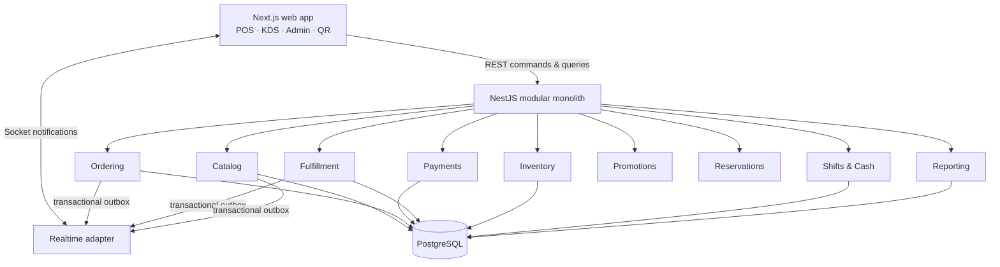

# Kế hoạch triển khai Chick-Res

> **Trạng thái:** kế hoạch thực thi đã self-review cho repository hiện tại  
> **Mục tiêu MVP:** thu ngân tạo và thu tiền đơn tại quầy, bếp/đóng gói xử lý đơn theo thời gian thực, quản lý ca và có dấu vết tồn kho đủ để đối soát.  
> **Kiến trúc được chọn:** modular monolith — một NestJS API, một Next.js web app, một PostgreSQL. Redis và worker chỉ được thêm khi một nhu cầu đo được đòi hỏi chúng.
> **Kế hoạch phát hành:** pilot vận hành lõi cuối tuần 10; hoàn tất toàn bộ scope/màn hình MVP và UAT cuối tuần 16.

## 1. Hiện trạng và quyết định phạm vi

Repository hiện có hai ứng dụng độc lập:

- `BE/`: NestJS 12 scaffold (`AppModule`, controller `GET /`) với Vitest và Dockerfile.
- `FE/`: Next.js 16 App Router scaffold, Tailwind v4, cấu hình `output: "standalone"` và Dockerfile.
- `compose.yml`: chỉ chạy FE và BE; PostgreSQL, Redis, ORM, xác thực, WebSocket, state/query library và nghiệp vụ chưa được cài đặt.

Vì chưa có dữ liệu hay contract sản xuất, lựa chọn thiết kế sau đây là điểm khởi đầu, không phải migration tương thích ngược.

### Phạm vi MVP

- Một chi nhánh/quán. Mọi bảng nghiệp vụ vẫn có `store_id` để không khóa đường mở rộng đa chi nhánh.
- POS tại quầy, đơn ăn tại chỗ và mang về; tiền mặt và QR chuyển khoản có xác nhận thủ công trong MVP.
- Menu, modifier, combo cơ bản; giá được chốt thành snapshot khi xác nhận đơn.
- KDS, đóng gói, mẻ chiên và tủ giữ nóng ở mức vận hành được.
- Mở/đóng ca, sổ quỹ tiền mặt, nhập/kiểm kê/hủy kho và báo cáo ca cơ bản.
- Website public: giới thiệu quán/chương trình, voucher đang hiệu lực và đặt bàn trực tuyến. Admin cấu hình campaign, voucher, giờ nhận bàn và xử lý reservation.

Toàn bộ screen inventory trong tài liệu là cam kết cho MVP 16 tuần, không phải 12 tuần. Pilot tuần 10 chỉ bao gồm Catalog, POS tiền mặt/QR xác nhận thủ công, KDS, ca tiền mặt, kho receipt/ledger/count và dashboard cơ bản. Booking, QR self-order, voucher redemption, báo cáo đầy đủ, offline draft và UAT hoàn chỉnh được hoàn thành sau pilot.

### Không thuộc MVP

- Tích hợp trực tiếp Momo/VNPay/card terminal, webhook và refund tự động.
- Đồng bộ offline đầy đủ giữa nhiều thiết bị, đa chi nhánh, loyalty, delivery marketplace.
- Microservice, event bus phân tán, data warehouse hoặc CQRS framework.
- Điều khiển máy in qua Web Bluetooth/Web Serial. Giai đoạn đầu dùng print bridge cục bộ hoặc in bằng trình duyệt; driver ESC/POS là một integration riêng sau UAT.

## 2. Kiến trúc mục tiêu

Chọn **Prisma + PostgreSQL** cho schema, migration và transaction. Không duy trì đồng thời Prisma và TypeORM. Database schema chỉ thay đổi qua migration được review; tuyệt đối không bật `db push`/schema synchronize trong môi trường UAT hoặc production.



### Quy tắc ranh giới

- Mỗi capability sở hữu bảng, invariant và ghi dữ liệu của chính nó. Module khác gọi application service đã export, đọc read model được thiết kế rõ ràng, hoặc phản ứng với outbox event.
- Controller và Socket gateway chỉ xác thực, validate DTO, gọi use case và map response; không chứa logic giá, trạng thái hay truy vấn Prisma trực tiếp.
- Provider là private mặc định. Không export `PrismaService`, Prisma model hoặc repository để module khác tự ghi bảng của module sở hữu.
- Không dùng `forwardRef()`. Vòng phụ thuộc phải được giải bằng xác định lại ownership, public operation hẹp, hoặc event sau commit.
- Socket là kênh thông báo có thể mất kết nối, không phải nguồn sự thật. Sau reconnect, client tải lại trạng thái qua REST bằng `updatedAt`/revision.
- Redis chưa là dependency của MVP. Khi triển khai nhiều API instance hoặc cần queue in/retry, thêm Redis adapter/worker sau khi có idempotency, retry và metric backlog rõ ràng.

### Cấu trúc backend đích

```text
BE/src/
  app.module.ts
  config/                 # environment validation, composition
  database/               # Prisma client, migration/runtime health
  identity/               # users, roles/permissions, sessions, store context and policies
  catalog/                # products, option groups, combos, price schedules
  ordering/               # cart validation, price snapshot, order lifecycle
  payments/               # cash/QR confirmation, payment attempts, refund policy
  fulfillment/            # KDS ticket, batch frying, holding, packing/handover
  inventory/              # recipes, stock ledger, counts, waste, low stock
  shifts/                 # opening/closing shift, cash movements, reconciliation
  promotions/             # campaigns, vouchers, redemption rules/history
  reservations/           # table availability, booking, arrival/no-show
  reporting/              # read-only reports and aggregate queries
  realtime/               # outbox dispatcher and Socket adapter
  shared/                 # cross-cutting primitives only: ids, money, errors
```

`shared/` không được chứa service nghiệp vụ, DTO dùng chung tùy tiện hoặc entity Prisma.

### Frontend đích

```text
FE/src/
  app/
    (staff)/pos/ (staff)/kds/ (admin)/ ...
    (public)/                         # landing page, campaigns, vouchers, reservations
      page.tsx                         # /
      vouchers/page.tsx                # /vouchers
      reservations/page.tsx            # /reservations
    order/[tableToken]/                 # QR public route, scope hẹp
  features/
    auth/ catalog/ pos/ kds/ shifts/ inventory/ promotions/ reservations/ reports/
  lib/
    api/ realtime/ money/ offline/
  components/ui/                        # shadcn/ui primitives
```

- TanStack Query quản lý server state và invalidation; Zustand chỉ giữ UI state cục bộ như cart chưa gửi, thiết bị/printer preference và trạng thái ca đang mở.
- Server Components cho màn hình đọc/admin khi phù hợp; POS và KDS là Client Components do cần thao tác, timer và Socket.
- Không để token JWT dài hạn trong `localStorage`; dùng cookie httpOnly hoặc cơ chế session đã chọn tại module `identity`.
- Public landing page là một trải nghiệm riêng: hero ưu đãi nổi bật, voucher có điều kiện/hiệu lực rõ ràng và form đặt bàn luôn thấy được. Trang responsive, có metadata/SEO, không tải bundle POS/KDS hoặc dữ liệu staff. URL, API path, query parameter, event name, DTO field và code identifier dùng tiếng Anh; nội dung UI có thể là tiếng Việt.

### Danh mục màn hình quản lý và vận hành (MVP)

Đây là screen inventory bắt buộc. Route có thể dùng tab/drawer cho thao tác chi tiết, nhưng không được bỏ qua capability tương ứng. `Admin` có toàn quyền; `Manager`, `Cashier`, `Kitchen` và `Inventory Clerk` chỉ thấy route được cấp quyền.

| Nhóm | Route FE (English) | Mục đích chính | Vai trò |
|---|---|---|---|
| Dashboard | `/admin` | Doanh thu ca/ngày, order đang chờ, low stock, near expiry, booking hôm nay và cảnh báo cần xử lý. | Admin, Manager |
| Users & access | `/admin/users`, `/admin/roles`, `/admin/audit-logs` | Tạo/vô hiệu hóa nhân viên, gán role/permission và xem dấu vết thao tác quan trọng. | Admin |
| Store settings | `/admin/settings/store`, `/admin/settings/taxes`, `/admin/settings/receipt` | Thông tin quán, timezone, tax/rounding, đánh số hóa đơn và cấu hình mẫu receipt. | Admin |
| Catalog | `/admin/catalog/categories`, `/admin/catalog/products`, `/admin/catalog/option-groups`, `/admin/catalog/price-schedules` | Danh mục, món/variant, modifier, combo, giá theo thời gian và sold-out. | Admin, Manager |
| Promotions | `/admin/promotions/campaigns`, `/admin/promotions/vouchers`, `/admin/promotions/redemptions` | Tạo/publish campaign, quy tắc voucher/quota và tra lịch sử redeem. | Admin, Manager |
| Tables & reservations | `/admin/tables`, `/admin/reservations`, `/admin/reservations/calendar` | Sơ đồ bàn, giờ mở cửa/capacity, danh sách-lịch booking, xác nhận, check-in, cancel/no-show. | Admin, Manager, Cashier |
| Orders | `/admin/orders`, `/admin/orders/[orderId]` | Tìm/lọc đơn, xem payment/fulfillment timeline, hủy/refund theo quyền và lý do. | Admin, Manager, Cashier |
| Shift & cash | `/admin/shifts`, `/admin/shifts/[shiftId]`, `/admin/cash-movements` | Mở/đóng ca, chi tiết đối soát, khoản thu/chi và chênh lệch két. | Admin, Manager, Cashier |
| Inventory overview | `/admin/inventory` | Tồn hiện tại, hàng nhập hôm nay còn lại, low stock, near expiry và shortcut xử lý. | Admin, Manager |
| Inventory master data | `/admin/inventory/ingredients`, `/admin/inventory/suppliers`, `/admin/inventory/warehouses`, `/admin/inventory/locations` | Nguyên liệu/đơn vị, nhà cung cấp, kho khô/tủ mát/tủ đông và vị trí lưu trữ. | Admin, Manager |
| Inventory movements | `/admin/inventory/receipts`, `/admin/inventory/transfers`, `/admin/inventory/counts`, `/admin/inventory/ledger` | Nhập hàng, điều chuyển, kiểm kê/duyệt điều chỉnh và thẻ kho truy vết. | Admin, Manager, Inventory permission |
| Recipes & waste | `/admin/inventory/recipes`, `/admin/inventory/waste`, `/admin/inventory/expiry` | BOM revision, báo hủy, hàng sắp hết hạn và approval. | Admin, Manager, Kitchen (create waste only) |
| Reports | `/admin/reports/sales`, `/admin/reports/products`, `/admin/reports/shifts`, `/admin/reports/inventory` | Sales/COGS, top products, báo cáo ca/cash và variance tồn kho. | Admin, Manager |
| POS | `/pos` | Chọn món, modifier/combo, nhận payment, in receipt và tạo ticket. | Cashier |
| Frying KDS | `/kds/frying` | Demand theo loại gà, bắt đầu/hoàn thành mẻ và trạng thái tủ giữ nóng. | Kitchen |
| Packing KDS | `/kds/packing` | Ticket theo ưu tiên, pack, mark ready và handover. | Kitchen, Cashier |
| Public marketing | `/`, `/vouchers` | Giới thiệu quán/campaign, điều kiện voucher và CTA đặt bàn. | Public |
| Public booking & QR | `/reservations`, `/reservations/[accessToken]`, `/order/[tableToken]` | Đặt/tra cứu bàn và gọi món tại bàn bằng QR trong scope hẹp. | Public |

Màn list phải có search, filter, pagination và empty/loading/error state; màn chi tiết phải có timeline/audit phù hợp. Với dữ liệu tiền, tồn, voucher quota, reservation và order, thao tác chỉnh sửa/hủy cần confirmation, reason và kiểm tra quyền ở backend.

## 3. Ownership dữ liệu và workflow

| Capability | Sở hữu | Public contract tối thiểu |
|---|---|---|
| Identity | user, role, permission, user-store access, session, audit actor | xác thực, `requireActor`, policy theo store/resource, quản lý user/role |
| Catalog | product, variant, option group, combo rule, price schedule | menu bán được tại thời điểm yêu cầu, validate selection |
| Ordering | order, order item snapshot, order number, cancellation reason | tạo/confirm/cancel order, query ticket |
| Payments | payment attempt, payment event, refund | ghi nhận cash/QR, trạng thái thanh toán |
| Fulfillment | ticket, production batch, holding batch, allocation | queue KDS, bắt đầu/hoàn thành batch, pack/handover |
| Inventory | ingredient, supplier, warehouse/location, receipt, lot, unit conversion, recipe revision, inventory ledger, count, transfer, waste | availability query, nhập kho, tồn theo lô/vị trí/thời điểm, stock movement, variance |
| Shifts | shift, cash movement, close reconciliation | mở/đóng ca, ghi thu/chi |
| Promotions | campaign, voucher rule/code, redemption | voucher đang hiệu lực, validate/apply voucher, lịch sử sử dụng |
| Reservations | table, opening hours, slot/capacity, reservation, arrival/no-show | tìm slot trống, tạo/xác nhận/hủy booking, check-in |
| Reporting | read projections/query | doanh thu, cash, top product, variance |

### State machines bắt buộc

Không dùng một trường `Order.status` cho mọi quá trình.

| Aggregate | Trạng thái MVP | Quy tắc chính |
|---|---|---|
| Order | `DRAFT → AWAITING_PAYMENT → CONFIRMED → CLOSED`; có thể `CANCELLED` từ mọi trạng thái trước `CLOSED` | Chỉ order `CONFIRMED` đi vào fulfillment. `CLOSED` chỉ được tạo khi ticket đã `HANDED_OVER`; cancel phải có reason và actor. |
| Payment | `PENDING → CAPTURED` hoặc `FAILED` / `VOIDED` / `REFUNDED` | Một external attempt có idempotency key riêng. |
| Fulfillment ticket | `QUEUED → PREPARING → READY → HANDED_OVER` hoặc `VOIDED` | Không tự suy ra payment status. |
| Shift | `OPEN → CLOSING → CLOSED` | Không tạo cash sale vào shift đã đóng. |

Mỗi chuyển trạng thái ghi actor, timestamp và reason khi cần. Endpoint command yêu cầu `Idempotency-Key`; database có unique constraint theo `store_id + idempotency_key` để retry không tạo đơn/thu tiền trùng.

### Ma trận hủy đơn, hoàn tiền và voucher

| Tình huống | Xử lý bắt buộc |
|---|---|
| `DRAFT` hoặc `AWAITING_PAYMENT` hết hạn/hủy | Không tạo ticket hay inventory movement; payment `PENDING` được `VOIDED`; voucher quote/redeem reservation được release. |
| `CONFIRMED`, chưa có sản xuất/đóng gói | Void ticket, release demand; nếu payment đã `CAPTURED`, manager thực hiện refund/chi tiền riêng rồi mới hoàn tất cancel. |
| Đã tiêu hao cho mẻ hoặc đã pack, chưa hand over | Không tự đảo inventory ledger. Manager tạo exception: hàng an toàn thì trả về holding stock, còn lại tạo `WASTE`; payment refund vẫn là transaction/cash movement riêng. |
| `CLOSED` sau hand over | Không đổi Order sang `CANCELLED`; chỉ tạo refund/complaint record theo quyền, không tạo negative sale hay xóa lịch sử. |

Voucher được **redeem tại transaction capture payment**, không phải chỉ khi khách nhập code. Khi cancel/refund, Promotions tạo release/reversal phù hợp để quota và lịch sử redemption nhất quán. Refund tiền mặt bắt buộc ghi `cash_movement` gắn order/payment/refund actor; chỉ Manager/Admin được duyệt vượt ngưỡng cấu hình.

### Chính sách tồn kho và bếp mẻ

- `inventory_ledger` là nguồn sự thật tăng/giảm tồn; `stock_balance` là projection có thể tái tạo, không được sửa trực tiếp.
- `recipe_revision` được snapshot vào order/production batch để thay đổi BOM không làm sai dữ liệu quá khứ.
- Xác nhận đơn tạo `demand` phục vụ KDS và cảnh báo thiếu hàng, **không tạo hard reservation hay thay đổi tồn kho** trong Release 1. Sold-out vẫn do Manager/Catalog kiểm soát.
- Bắt đầu mẻ ghi `PRODUCTION_ISSUE` cho nguyên liệu và tạo `holding_batch`; đóng gói phân bổ hàng giữ nóng, đồng thời ghi tiêu hao trực tiếp cho side/packaging nếu có.
- Hết hạn tủ ủ, hủy món và chênh lệch kiểm kê tạo `waste`/adjustment có reason, actor và quyền duyệt.

### Nghiệp vụ nhập kho, tồn hôm nay và lưu trữ

Inventory phải quản lý theo **kho/vị trí/lô**, không chỉ theo tên nguyên liệu. Các aggregate và dữ liệu tối thiểu:

| Dữ liệu | Mục đích |
|---|---|
| `supplier`, `purchase_reference` | Nhà cung cấp và số phiếu/hoá đơn nhập; có thể nhập thủ công khi chưa có purchasing module. |
| `warehouse`, `storage_location` | Ví dụ: kho khô, tủ đông, tủ mát, quầy pha chế. Vị trí có mã, trạng thái active và tuỳ chọn nhiệt độ/capacity; không dùng vị trí tủ ủ nóng của KDS thay cho kho. |
| `goods_receipt`, `goods_receipt_line` | Phiếu nhận hàng: ngày giờ nhận, người nhận, supplier, số lượng đặt/nhận/thực nhận, đơn vị, giá vốn, vị trí nhận. Chỉ `POSTED` mới làm tăng tồn; void phải tạo bút toán đảo, không xoá phiếu. |
| `inventory_lot` | Lô nhận hàng với `received_at`, batch/lot number, expiry date, unit cost và vị trí ban đầu. Có thể theo dõi hạn dùng/FEFO cho thịt gà, sốt, rau; vật tư rẻ có thể không bắt buộc lot. |
| `inventory_ledger`, `stock_balance` | Ledger ghi `RECEIPT`, `TRANSFER_OUT/IN`, `PRODUCTION_ISSUE`, `WASTE`, `COUNT_ADJUSTMENT`, `RETURN`; balance được tổng hợp theo `store + location + ingredient + lot` và có `as_of` timestamp. |
| `stock_count` | Phiếu kiểm kê theo location; chênh lệch chỉ tạo adjustment sau khi người có quyền duyệt. |

Các màn hình/report bắt buộc của Admin:

- **Nhập kho hôm nay:** tổng số lượng/giá trị các receipt đã `POSTED` trong ngày, lọc theo supplier, nguyên liệu và kho.
- **Còn lại của hàng nhập hôm nay:** tổng `on_hand` của các `inventory_lot.received_at` trong ngày; drill-down đến từng lô/vị trí. Con số này khác với tổng tồn hiện tại vì hàng cũ vẫn có thể còn.
- **Tồn tại thời điểm hiện tại:** `opening + receipts + transfer in - production issue - waste - transfer out ± approved adjustment`; hiển thị theo nguyên liệu, kho, vị trí và lô.
- **Tồn lưu trữ:** danh sách tồn trong kho khô/tủ mát/tủ đông, tuổi lô, hạn dùng, low stock và near-expiry; xuất/điều chuyển theo FEFO khi nguyên liệu có hạn dùng.
- **Thẻ kho:** mọi movement của một nguyên liệu/lô trong khoảng thời gian, có người thao tác và chứng từ gốc để truy vết.

Mọi báo cáo theo ngày dùng `occurred_at` theo timezone của quán, không dùng `created_at`; “tồn tại thời điểm” phải nhận timestamp để vẫn trả lời được số tồn sau khi có điều chỉnh ghi muộn.

## 4. Giao dịch, realtime và bảo mật

### Transaction và outbox

Một command làm thay đổi nghiệp vụ thực hiện trong transaction ngắn của PostgreSQL: ghi aggregate, audit record cần thiết và `outbox_event` cùng transaction. Dispatcher sau commit đẩy event ra Socket; nếu tiến trình chết, event chưa publish được retry. Consumer/client phải xử lý event trùng bằng event ID và revision.

Không gọi payment provider, printer, Socket hay API bên ngoài khi đang giữ transaction/lock database.

Các event MVP: `order.confirmed`, `order.cancelled`, `ticket.updated`, `catalog.availability_changed`, `inventory.stock_changed`, `voucher.redeemed`, `voucher.released`, `reservation.updated`, `shift.closed`. Event có `eventId`, `storeId`, aggregate ID, revision, occurredAt và schema version. Chỉ event mà client cần cập nhật tức thì mới được phát Socket; event còn lại vẫn giữ trong outbox/audit để retry và reporting.

### Authorization và public QR

#### RBAC thống nhất giữa BE và FE

**BE là nguồn sự thật cho quyền.** FE không tự suy luận quyền từ tên role và không duy trì enum permission thủ công. Identity sở hữu các bảng `roles`, `permissions`, `role_permissions`, `user_roles`, `user_store_access` và `sessions`; các default role được seed là `Admin`, `Manager`, `Cashier`, `Kitchen`, `Inventory Clerk`, nhưng mapping role → permission có thể quản lý tại `/admin/roles`.

Permission là string tiếng Anh theo `resource.action`, ví dụ `catalog.read`, `catalog.write`, `catalog.price.publish`, `orders.read`, `orders.create`, `orders.cancel.request`, `orders.cancel.approve`, `payments.capture`, `payments.refund.approve`, `inventory.receipt.post`, `inventory.adjust.approve`, `inventory.waste.approve`, `shifts.close`, `promotions.publish`, `reservations.manage`, `reports.read`, `users.manage` và `roles.manage`. Catalog này được định nghĩa/seed tại BE, xuất hiện trong OpenAPI và được FE sinh type từ contract.

1. Login chỉ cấp credential cho staff sau khi password Argon2 được xác thực. Access token ngắn hạn chứa `userId`, `sessionId` và `tokenVersion`, đặt trong cookie `HttpOnly`, `Secure`, `SameSite=Lax`; refresh session được rotate. Token không là nơi quyết định permission hay `storeId`.
2. `AuthenticationGuard` xác minh issuer, audience, algorithm, expiry, token/session chưa bị revoke và lấy `ActorContext` hiện hành từ Identity: `userId`, `sessionId`, permissions, store scopes và `authVersion`. Vô hiệu hóa user, logout hoặc đổi quyền sẽ revoke/increment version để request kế tiếp bị từ chối.
3. Mọi staff endpoint mặc định deny. Controller khai báo `@RequirePermissions(...)`; `AuthorizationGuard` kiểm tra permission tổng quát. Application operation tiếp tục kiểm tra resource/state: `storeId` của record, ca thuộc actor, limit refund, trạng thái order/ticket. Không chấp nhận `storeId`, role hay permission do client tự khai là nguồn phân quyền.
4. Mọi bảng nghiệp vụ có `store_id` bắt buộc. Query/write luôn bind store scope từ `ActorContext`; các quan hệ chéo store bị chặn bằng policy và database constraint phù hợp. `activeStoreId` chỉ được server chọn từ `user_store_access`, dù MVP chỉ có một quán.
5. KDS/POS mutation đi qua REST command đã guard; Socket chỉ phát notification/read-model. Nếu sau này nhận command qua Socket, gateway phải tạo cùng `ActorContext` và gọi đúng application operation, không có đường bypass guard.

`GET /api/v1/auth/me` trả projection an toàn gồm user, store scopes, permission strings và `authVersion`. FE dùng đúng response typed này cho `RoutePolicy`, menu/sidebar và `PermissionGate`; middleware/server layout chỉ redirect người chưa login, còn API mới là nơi quyết định `401`/`403`. Khi nhận `401`, FE xóa UI session và về login; `403` chỉ hiển thị “không có quyền”, không retry bằng role khác. Không đặt JWT dài hạn trong `localStorage`.

Public route phải dùng `@Public()` rõ ràng thay vì bỏ guard toàn cục: QR token chỉ tạo draft order của đúng table/store; voucher public chỉ đọc campaign published; booking token chỉ đọc đúng booking. Các route này có DTO allow-list, rate limit theo IP/phone, origin/CSRF policy phù hợp cookie và không có quyền staff.

Audit record cho action nhạy cảm chứa actor, session, store, permission, target type/ID, result, reason và correlation ID; không log password, token, full payment data hoặc thông tin cá nhân không cần thiết.

### Public website, voucher và đặt bàn

Public routes tối thiểu là `/` (giới thiệu và campaign đang chạy), `/vouchers` (điều kiện ưu đãi) và `/reservations` (form booking). Chúng chỉ đọc campaign đã `PUBLISHED`, không dùng session staff và không trả về dữ liệu vận hành/quản trị.

- **Campaign/voucher:** Admin tạo `DRAFT → PUBLISHED → EXPIRED/DISABLED`, đặt thời gian hiệu lực, quota tổng/quota mỗi khách, giá trị giảm, đơn tối thiểu và đối tượng áp dụng. Public page hiển thị điều kiện, hạn dùng và CTA “Đặt bàn”; code chỉ được redeem khi Ordering gọi Promotions validate trên server, trong transaction tạo `voucher_redemption` để không vượt quota.
- **Booking:** Khách chọn ngày, giờ, số khách, tên và số điện thoại; server kiểm tra opening hours, lead time, sức chứa/slot và booking trùng. Reservation đi theo `PENDING → CONFIRMED → ARRIVED → SEATED → COMPLETED`, hoặc `CANCELLED/NO_SHOW`. Trong MVP, manager/cashier xác nhận booking và gán bàn; khách chỉ thấy mã booking cùng trạng thái của chính mình qua token tra cứu ngắn hạn.
- **Chống overbook:** reservation giữ một `capacity_slot` hoặc table đã gán trong transaction; unique/exclusion constraint và lock theo slot là nguồn chống trùng, không dựa vào việc frontend đã ẩn giờ hết chỗ. Cần release capacity khi cancel/no-show theo chính sách đã công bố.
- **Chống spam và riêng tư:** rate limit theo IP/phone, CAPTCHA hoặc OTP được đưa vào sau nếu UAT thấy abuse; phone chỉ phục vụ booking/notification, giới hạn quyền xem và retention period được xác định trước go-live.
- **Thiết kế luồng:** mobile-first, form tối đa hai bước (chọn thời gian/số khách → thông tin liên hệ), hiển thị các slot còn chỗ do API trả về và trạng thái submit/error rõ ràng. Voucher không tự động được coi là thanh toán hoặc giữ bàn nếu điều kiện chưa thỏa.

### Quy ước tên route và API

- Dùng danh từ tiếng Anh, lowercase và kebab-case cho URL: `/pos`, `/kds`, `/admin/inventory/receipts`, `/vouchers`, `/reservations`, `/orders/:orderId`.
- API versioned dưới `/api/v1`, ví dụ: `POST /api/v1/reservations`, `GET /api/v1/reservation-slots`, `GET /api/v1/vouchers`, `POST /api/v1/orders/:orderId/voucher-redemptions`.
- Resource dùng số nhiều; action không phải CRUD phải là động từ rõ nghĩa, ví dụ `POST /orders/:orderId/confirm`, `POST /fulfillment-tickets/:ticketId/mark-ready`, `POST /shifts/:shiftId/close`.
- Không dùng URL/endpoint tiếng Việt, viết tắt mơ hồ hoặc camelCase; UI label vẫn dịch theo locale như “Đặt bàn”, “Voucher”, “Nhập kho”.

### Permission matrix tối thiểu

| Role | Quyền được cấp | Phân tách trách nhiệm |
|---|---|---|
| Admin | Cấu hình store/tax, users/roles, menu, promotion, report và override có audit. | Không tự duyệt stock count, waste hoặc refund do chính mình tạo. |
| Manager | Duyệt price/promotion, reservation, void/refund trong ngưỡng, count adjustment/waste, close shift. | Không sửa role/permission hoặc xóa audit log. |
| Cashier | POS, mở/đóng ca của mình, cash movement được cấp, check-in booking, request cancel/refund. | Không publish voucher, sửa giá/BOM, duyệt refund/adjustment của chính mình. |
| Kitchen | Xem KDS, quản lý batch/holding, tạo waste request. | Không thấy doanh thu, giá vốn, cash hoặc thực hiện inventory adjustment. |
| Inventory Clerk | Tạo receipt/transfer/count/waste request và xem stock. | Không tự post receipt void, duyệt count adjustment/waste hoặc truy cập cash/report doanh thu. |

Permission được check ở API theo action, không dựa vào route/UI. Các action nhạy cảm (`refund.approve`, `inventory.adjust.approve`, `inventory.waste.approve`, `receipt.void`, `campaign.publish`) ghi audit record và cần reason.

### Offline theo từng cấp độ

MVP không hứa “offline hoàn toàn”. Phased delivery:

1. **Online-first:** cache menu và retry request an toàn.
2. **Offline draft:** IndexedDB chỉ lưu cart/draft chưa thanh toán; không in hóa đơn chính thức hoặc tạo KDS ticket.
3. **Offline sale pilot:** chỉ sau UAT; mỗi device có ID cố định, monotonic local sequence, idempotency key, price snapshot, conflict queue và thao tác đối soát manager. Quyết định này cần một local backend hoặc quy tắc vận hành chấp nhận rủi ro tồn kho/numbering.

## 5. Lộ trình 16 tuần và đầu ra kiểm chứng được

| Giai đoạn | Thời gian | Công việc trong source | Exit criteria |
|---|---:|---|---|
| 0. Foundation | Tuần 1 | Thêm Postgres vào `compose.yml`; Prisma/schema/migration đầu tiên; config validation; health/readiness; global validation/error format; CI lint/test/build. Thêm auth skeleton và store context. | `docker compose up` khởi động FE, BE, Postgres; migration chạy idempotent; API health không lộ secret. |
| 1. Identity & catalog | Tuần 2–3 | Identity/RBAC, permission catalog/default roles/session revocation, `GET /auth/me`; Catalog module; admin CRUD product, option group, combo rule, price schedule và sold-out; FE typed RoutePolicy/menu query. | Cashier chỉ đọc menu thuộc store; đổi role/deactivate có hiệu lực request kế tiếp; direct API cross-store bị `403`; invalid modifier/price bị server từ chối; menu version đổi được thông báo realtime. |
| 2. POS, order, cash | Tuần 4–5 | Ordering, Payments cash/QR-manual, Shifts/cash ledger; POS touch flow; order/item snapshots; receipt HTML/browser print; idempotency/outbox. Chỉ tạo promotion extension point, chưa redeem voucher. | Gửi cùng command hai lần chỉ có một order/payment; đổi giá sau bán không làm đổi receipt; refund/cancel tuân theo ma trận; đóng ca đối soát được cash sale, refund và cash movement. |
| 3. KDS & fulfillment | Tuần 6–7 | Socket adapter, KDS/packing screens, ticket state machine, batch frying/holding data model và timer hiển thị. | KDS reconnect nhận đầy đủ ticket hiện hành; ticket chỉ sẵn sàng qua transition hợp lệ; event bị gửi lại không làm lùi trạng thái. |
| 4. Inventory & variance | Tuần 8–10 | Supplier, warehouse/location, goods receipt, lot/expiry, UOM, recipe revision, ledger, transfer, count, waste và low stock; liên kết demand/batch/waste với fulfillment. | Không sửa trực tiếp balance; mỗi thay đổi tồn có ledger entry; xem được nhập hôm nay, còn lại của lô nhập hôm nay và tồn theo kho/vị trí/lô; report variance truy ra được source transaction. Pilot vận hành lõi cuối tuần 10. |
| 5. Public web, promotions & reservations | Tuần 11–12 | Landing page quảng cáo campaign/voucher; Admin cấu hình/publish campaign; public table booking, capacity và check-in. Tích hợp voucher quote/redeem/release với POS. | Voucher chỉ hiện khi published/còn hiệu lực và không vượt quota; booking không overbook; cancel/refund xử lý voucher đúng rule. |
| 6. QR & reports | Tuần 13 | Table QR token, public draft order flow, payment-at-counter; report day/shift, top product, cash variance và theoretical-vs-actual. | QR token không truy cập API staff; report khớp dữ liệu order/payment/ledger seed; pagination, store scope và export được kiểm thử. |
| 7. Reliability & UAT | Tuần 14–16 | Offline draft cache, retry/reconnect, test concurrency/load chọn lọc, backup/restore drill, logs/metrics, runbook, permission/audit review và UAT với quán. Đánh giá print bridge và payment provider thật. | UAT scripts đạt; backup restore được rehearsal; có dashboard/log để truy vết order ID; danh sách issue có owner và rollout/rollback plan. |

## 6. Thứ tự implementation cho từng capability

Mỗi capability ưu tiên làm ra luồng chạy được trước, có thể review độc lập:

1. Chốt luồng người dùng, state/invariant và dữ liệu phải lưu.
2. Tạo Prisma migration, constraints/indexes và seed tối thiểu.
3. Viết application operation, REST DTO/authorization và kết nối FE bằng typed API client/query hooks.
4. Hoàn thiện màn hình với loading/error/empty state, rồi chạy walkthrough thủ công bằng dữ liệu seed.
5. Nếu command làm thay đổi tiền, kho, quyền hoặc có downstream effect: thêm transaction/outbox/idempotency trước khi handover.
6. Chỉ thêm automated smoke test nhỏ cho flow có rủi ro mất tiền, sai tồn hoặc lộ quyền; các test mở rộng để sau UAT.

## 7. Xác minh chức năng MVP

MVP **không đặt mục tiêu coverage hoặc bộ test đầy đủ**. Mỗi màn/chức năng được xem là xong khi người dùng chạy được luồng chính trên FE, dữ liệu hiển thị/lưu đúng trong PostgreSQL và quyền được BE từ chối khi không hợp lệ.

### Checklist walkthrough bắt buộc

- Admin đăng nhập, tạo menu/giá/nhân viên; Cashier chỉ nhìn thấy đúng màn hình và dữ liệu store của mình.
- Cashier mở ca → tạo đơn → nhận cash/QR thủ công → in receipt → KDS nhận ticket → Kitchen pack/handover → đóng ca có số đối soát.
- Inventory Clerk nhập receipt hôm nay → tồn tăng đúng ở kho/lô/vị trí → điều chuyển/kiểm kê/waste hiển thị ở thẻ kho và “còn lại của lô nhập hôm nay”.
- Manager tạo/publish voucher → khách thấy trên `/vouchers` → voucher dùng được một lần đúng điều kiện; hủy/refund cập nhật quota và cash movement đúng quy tắc.
- Khách đặt bàn tại `/reservations`; staff xác nhận/check-in; cùng một bàn/slot không thể được xác nhận trùng.
- QR table token chỉ tạo draft order đúng bàn; public user không truy cập bất cứ API/màn staff nào.
- KDS/POS reconnect vẫn tải lại được trạng thái hiện tại từ REST, không phụ thuộc vào một event Socket đã lỡ.

### Automated smoke tối thiểu

- Build/lint chạy được; migration áp dụng được trên PostgreSQL mới.
- Một E2E smoke cho luồng POS hoàn chỉnh và một smoke cho booking/public QR.
- Kiểm tra duplicate `Idempotency-Key` không tạo double order/payment; receipt `POSTED` không tăng tồn hai lần.
- Kiểm tra direct API không có session là `401`, không có permission hoặc sai store là `403`.

Các test load, coverage, matrix permission đầy đủ, failure/retry chuyên sâu và report reconciliation mở rộng được chuyển sang UAT hoặc phase sau. Các chỉ số UAT cần đo: thời gian tạo đơn POS, thời gian KDS nhận ticket, Socket reconnect recovery và query menu.

## 8. Danh sách dependency và quyết định trước khi code

| Nhóm | Cần thêm khi bắt đầu giai đoạn tương ứng |
|---|---|
| Database | `prisma`, `@prisma/client`, PostgreSQL image/driver, migration/seed scripts |
| Auth/validation | `@nestjs/config`, Passport/JWT adapter, Argon2, throttling/rate-limit adapter, `class-validator`, `class-transformer` hoặc validation schema thống nhất |
| Realtime | `@nestjs/websockets`, Socket.io server/client; Redis adapter chỉ khi scale nhiều instance |
| FE data/UI | TanStack Query, Zustand, shadcn/ui theo component được dùng |
| Test/operations | test PostgreSQL container/service, seed fixtures, structured logger, health check |

### Vận hành database, deploy và API contract

- PostgreSQL trong `compose.yml` dùng named volume; database không expose public port ngoài môi trường local. Secret chỉ nằm trong environment/secret store, không commit vào `.env` mẫu.
- Migration production chạy bởi một release job duy nhất (`prisma migrate deploy`) trước khi API replica mới nhận traffic. API không tự chạy migration khi startup; migration lỗi dừng rollout và được forward-fix hoặc restore theo runbook.
- Backup logical hằng ngày được lưu ở encrypted storage với retention tối thiểu 30 ngày; backup/restore được owner vận hành kiểm tra mỗi tháng và rehearsal trong UAT. Provider/storage path cụ thể phải được quyết định trước deploy.
- `/health/live` chỉ chứng minh process sống; `/health/ready` kiểm tra kết nối PostgreSQL và cấu hình thiết yếu. Khi shutdown, API ngừng nhận request trước, hoàn tất request đang chạy rồi đóng connection pool.
- REST contract được công bố qua OpenAPI versioned; FE typed API client được generate từ contract trong CI. Mọi API change breaking cần version mới hoặc migration compatibility, không tự sửa response đang dùng.

Trước tuần 1, product owner cần xác nhận: một hay nhiều chi nhánh, quy tắc đánh số hóa đơn, thuế/rounding, ngưỡng duyệt refund/cancel, chính sách hủy/waste, booking hold/no-show, danh sách kho/vị trí lưu trữ, nguyên liệu nào bắt buộc theo lô/hạn dùng, quy tắc FEFO, retention dữ liệu khách và thiết bị in thực tế. Đây là các quyết định nghiệp vụ; không nên để frontend hoặc ORM tự ngầm định.

## 9. Rủi ro và cách giảm thiểu

| Rủi ro | Cách xử lý |
|---|---|
| Scope 16 tuần vẫn rộng | Pilot lõi ở tuần 10, chỉ go-live đầy đủ sau UAT tuần 16; payment gateway thật, offline sale, multi-store và printer driver vẫn ngoài MVP. |
| Sai lệch kho | Ledger bất biến, recipe revision, count/waste có approval, báo cáo truy ngược. |
| Double charge/double order | Idempotency ở database, payment attempt riêng, webhook chỉ thêm sau khi có duplicate test. |
| Mất Socket | REST là nguồn khôi phục trạng thái; outbox + revision, không dựa vào Pub/Sub best-effort. |
| Mất mạng tại quầy | Bắt đầu với offline draft; chỉ mở offline sale sau pilot và quy trình reconciliation. |
| In lỗi theo browser/OS | Dùng print bridge hoặc browser print trong UAT; xác nhận model máy in trước ESC/POS integration. |

## 10. Điều không thay đổi nếu sau này tách service

Chỉ cân nhắc worker/service riêng khi capability có ranh giới độc lập về ownership, deployment, scale, data hoặc failure. `realtime`/print có thể thành worker trước; catalog, ordering và inventory vẫn dùng một database ownership rõ ràng trong modular monolith. Không tách service nếu còn phải ghi chung bảng hoặc phải release đồng thời.
